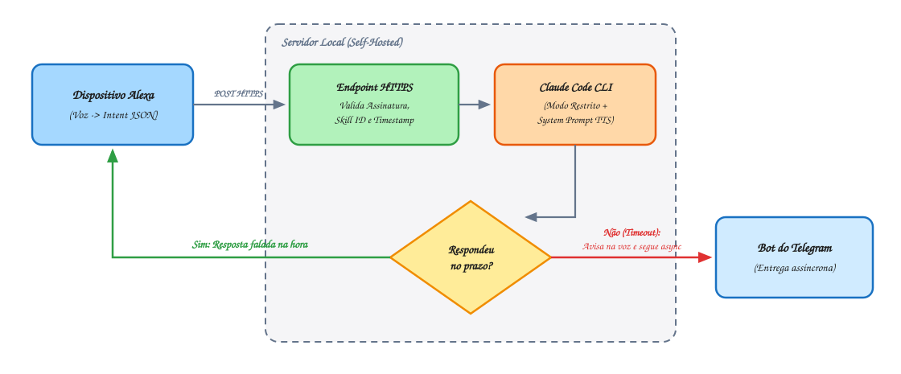

  

# claude-alexa

Ponte hospedada localmente entre uma [Alexa Custom Skill](https://developer.amazon.com/en-US/alexa/alexa-skills-kit) e o [Claude Code CLI](https://www.npmjs.com/package/@anthropic-ai/claude-code). Você faz uma pergunta por voz, o servidor local repassa ao Claude e a resposta volta falada, ou cai no Telegram se demorar.

> **Na prática:**  
> **Você:** Alexa, abra meu assistente.  
> **Alexa:** Bem-vindo.  
> **Você:** quantas issues estão abertas no meu nome  
> **Alexa:** *(fala a resposta que o Claude gerou)*  

## Como funciona

A Alexa transcreve sua voz, identifica a intenção e envia os dados assinados para o endpoint HTTPS do servidor. Após validar a requisição, o serviço chama o `claude` CLI com um *system prompt* ajustado para áudio, orientando respostas curtas, sem Markdown e sem perguntas de volta. A saída JSON do Claude é então convertida para o formato esperado pela Alexa.

A [documentação da Amazon](https://docs.aws.amazon.com/wellarchitected/latest/serverless-applications-lens/alexa-skills.html) impõe um limite rígido de 8 segundos para uma skill responder, sem possibilidade de extensão. Como chamadas de LLM com uso de ferramentas costumam passar desse tempo, o projeto trabalha com um prazo padrão de 7,5 segundos (`CLAUDE_RESPONSE_DEADLINE_MS`):

- Se o Claude responder dentro do prazo, a frase é falada pela própria Alexa na hora.
- Se passar do prazo, a Alexa avisa que a resposta chegará depois, encerra a interação de voz e o resultado completo é enviado pelo Telegram assim que o processo termina.

Caso queira priorizar respostas imediatas por voz, você pode reduzir `CLAUDE_MAX_TURNS`. Isso limita o uso de ferramentas e acelera a execução, embora tenda a gerar respostas mais curtas.

## Configuração

O passo a passo completo, desde a criação da skill no console da Amazon até a configuração do túnel HTTPS, está em [SETUP.md](SETUP.md).

## Segurança

Como a skill expõe uma CLI com acesso à máquina local, o serviço aplica três camadas de proteção:

- As requisições recebidas têm a assinatura digital da Amazon conferida, validando a cadeia de certificados, o `ALEXA_SKILL_ID` e o *timestamp* para bloquear pedidos antigos ou repetidos.
- O Claude roda com `CLAUDE_RESTRICTED=true` por padrão, tratando o texto transcrito pela voz como entrada não confiável para evitar *prompt injection*.
- As permissões de ferramentas ficam travadas em `.claude/settings.json` junto com a flag `--permission-prompts none`, garantindo que qualquer ferramenta fora da lista seja negada automaticamente sem travar o processo.