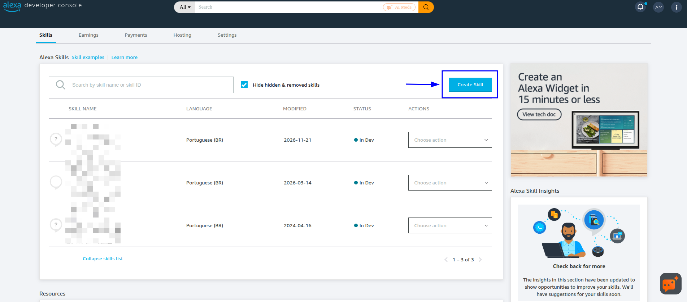
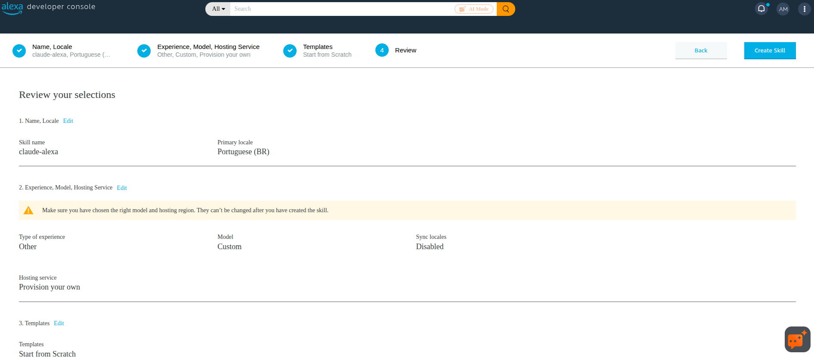
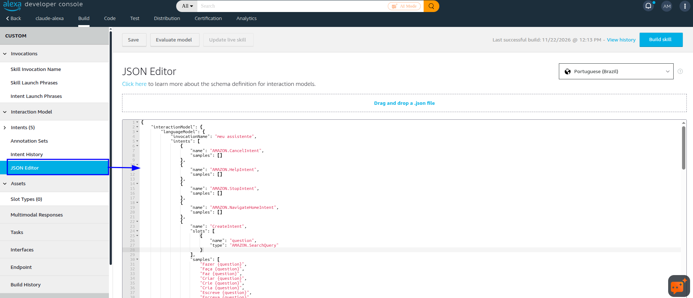
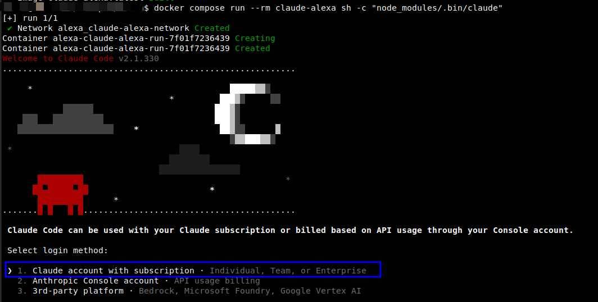
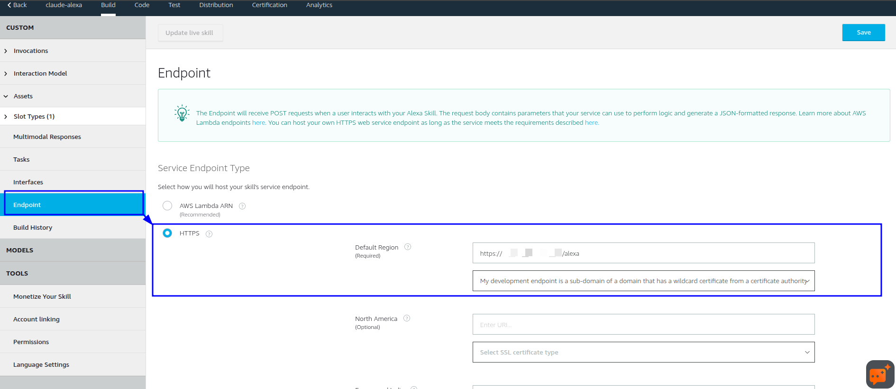
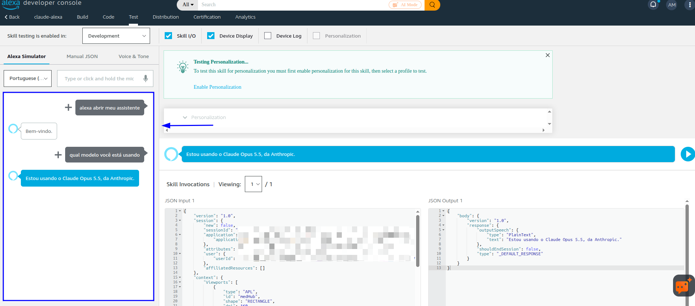

# Guia de configuração

Passo a passo completo do [claude-alexa](README.md), da criação da skill no Alexa Developer Console até a Alexa respondendo de verdade.

## Antes de começar

Para seguir este guia até o fim, você vai precisar de:

* **Conta no [Alexa Developer Console](https://developer.amazon.com/alexa/console/ask)** (gratuita), usada no passo 2.
* **Domínio próprio com HTTPS válido** apontando para o servidor onde o serviço vai rodar. A Alexa recusa qualquer endpoint sem HTTPS.
* **Docker e Docker Compose** instalados no servidor.
* **Assinatura Claude** (ou acesso à API da Anthropic) para autenticar o `claude` CLI no passo 4. O login é feito apenas uma vez.
* **Opcional:** um bot do Telegram (token e chat ID), caso queira receber as respostas que passarem do prazo da Alexa.

---

## 1. Baixe o projeto

```bash
git clone https://github.com/ArturMiguel/claude-alexa.git
cd claude-alexa
```

## 2. Crie a skill na Alexa

1. No [Alexa Developer Console](https://developer.amazon.com/alexa/console/ask), clique em **Create Skill**, dê um nome e selecione **Portuguese (BR)** como idioma.

   

2. Selecione **Other** como tipo de experiência, depois o modelo **Custom**, o método de hospedagem **Provision your own** e o template **Start from scratch**.

   

3. No menu lateral, acesse **Build > Interaction Model > JSON Editor** e substitua todo o conteúdo pelo arquivo [assets/alexa-skill.json](assets/alexa-skill.json).

   

   Esse JSON define o nome de invocação (`meu assistente`, que você pode alterar) e três intents (`QuestionIntent`, `CreateIntent`, `OpenIntent`). Os nomes das intents e do slot `question` devem permanecer iguais, pois é o contrato que o código em `src/alexa` espera receber.

4. Clique em **Save** e depois em **Build skill**.

5. Anote o **Skill ID** exibido no topo da página ou na URL (formato `amzn1.ask.skill.xxxxxxxx...`). Você vai precisar dele no próximo passo.

   

## 3. Configure o ambiente e o domínio HTTPS

Crie o arquivo de variáveis de ambiente a partir do exemplo:

```bash
cp .env.example .env
```

Preencha `ALEXA_SKILL_ID` no `.env` com o ID anotado no passo anterior (sem ele, o servidor rejeita qualquer requisição). As demais variáveis já vêm com valores padrão prontos para uso; veja a [tabela completa mais abaixo](#variáveis-de-ambiente). O `docker-compose.yml` lê o `.env` automaticamente.

Em seguida, configure seu proxy reverso ou túnel (Nginx, Caddy, Cloudflare Tunnel, etc.) para encaminhar requisições de `https://seudominio.com/alexa` para a porta local `3001` do servidor. Guarde essa URL pública para o passo 6.

## 4. Faça login no Claude

Construa a imagem e abra o terminal interativo do container para autenticar a CLI:

```bash
docker compose build
docker compose run --rm claude-alexa sh -c "node_modules/.bin/claude"
```



1. Selecione **Claude account with subscription**.
2. Abra o link exibido no navegador, autorize o acesso e copie o código OAuth gerado.
3. Cole o código de volta no terminal para concluir a autenticação.
4. Saia digitando `/exit`.

As credenciais ficam persistidas em um volume Docker, então esse processo não precisa ser repetido ao reiniciar o serviço.

## 5. Suba o serviço

Inicie o container em segundo plano:

```bash
docker compose up -d
```

Verifique se a aplicação responde corretamente:

```bash
curl http://127.0.0.1:3001/healthz
# {"status":"ok"}
```

## 6. Aponte o endpoint na Alexa

De volta ao console da Alexa, acesse **Build > Endpoint**, marque **HTTPS** e cole sua URL (`https://seudominio.com/alexa`) no campo **Default Region**.

Em **SSL certificate type**, escolha a opção correspondente à emissão do seu certificado:

* **My development endpoint has a certificate from a trusted certificate authority:** o certificado foi emitido exatamente para o domínio ou subdomínio do endpoint (ex: Let's Encrypt via Caddy ou Certbot).
* **My development endpoint is a sub-domain of a domain that has a wildcard certificate from a certificate authority:** o certificado é wildcard (`*.seudominio.com`), cobrindo todo o domínio. É o caso de quem usa Cloudflare, já que o Universal SSL é emitido nesse formato.

> **Atenção:** marcar a opção errada aqui é a causa mais comum da Alexa recusar o endpoint, mesmo quando a URL abre normalmente no navegador.



Clique em **Save Endpoints** e faça o **Build Model** novamente.

## 7. Teste

Na aba **Test** do console, mude o seletor **Skill testing is enabled in** para **Development**. Digite `"abrir meu assistente"` no simulador e faça uma pergunta na sequência.



Para testar em um dispositivo Echo físico, basta que ele esteja logado na mesma conta Amazon do Developer Console. Skills em desenvolvimento aparecem automaticamente no dispositivo sem precisar publicar ou certificar. Diga `"Alexa, abra meu assistente"` e faça sua pergunta.

---

## Variáveis de ambiente

| Variável | Padrão | Descrição |
| :--- | :--- | :--- |
| `ALEXA_SKILL_ID` | *(obrigatória)* | Skill ID anotado no passo 2. Pedidos com ID diferente são bloqueados antes de chegar ao Claude. |
| `CLAUDE_MODEL` | `haiku` | Modelo usado pelo `claude` CLI. O padrão prioriza baixa latência para respostas por voz. |
| `CLAUDE_EFFORT` | `low` | Nível de esforço de raciocínio passado para a CLI. |
| `CLAUDE_MAX_TURNS` | `3` | Limite de interações (incluindo chamadas de ferramentas) antes de forçar uma resposta. Valores menores aumentam a chance de responder no prazo da Alexa. |
| `CLAUDE_RESTRICTED` | `true` | Executa o Claude em modo restrito, tratando a transcrição de voz como entrada não confiável. Desative apenas se souber o risco. |
| `CLAUDE_RESPONSE_DEADLINE_MS` | `7500` | Tempo máximo (em ms) que a Alexa aguarda antes de encerrar a voz e delegar a resposta ao Telegram. |
| `TELEGRAM_BOT_TOKEN` | *(vazio)* | Token do bot para envio de respostas que estourarem o prazo. Deixe em branco para desativar. |
| `TELEGRAM_CHAT_ID` | *(vazio)* | ID do chat ou usuário de destino no Telegram. |
| `LOG_LEVEL` | `info` | Detalhamento dos logs (`fatal`, `error`, `warn`, `info`, `debug`, `trace`). Em `debug`, registra as perguntas e respostas do Claude. |

## Conectores (MCP)

Como o login do passo 4 usa sua conta Claude via OAuth, qualquer conector MCP já habilitado nela (GitHub, Google Calendar, etc.) é herdado automaticamente pela CLI, sem precisar configurar servidores extras neste projeto.

Porém, como o serviço roda com `--permission-prompts none`, qualquer ferramenta que exija confirmação interativa é negada por padrão. Para liberar ferramentas específicas, crie o arquivo de permissões a partir do exemplo:

```bash
cp .claude/settings.json.example .claude/settings.json
```

Adicione os nomes das ferramentas desejadas em `permissions.allow` seguindo o padrão `mcp__<conector>__<ferramenta>` (por exemplo, `mcp__github__create_issue`). Basta reiniciar o container (`docker compose up -d`) para aplicar, sem precisar rebuildar a imagem.